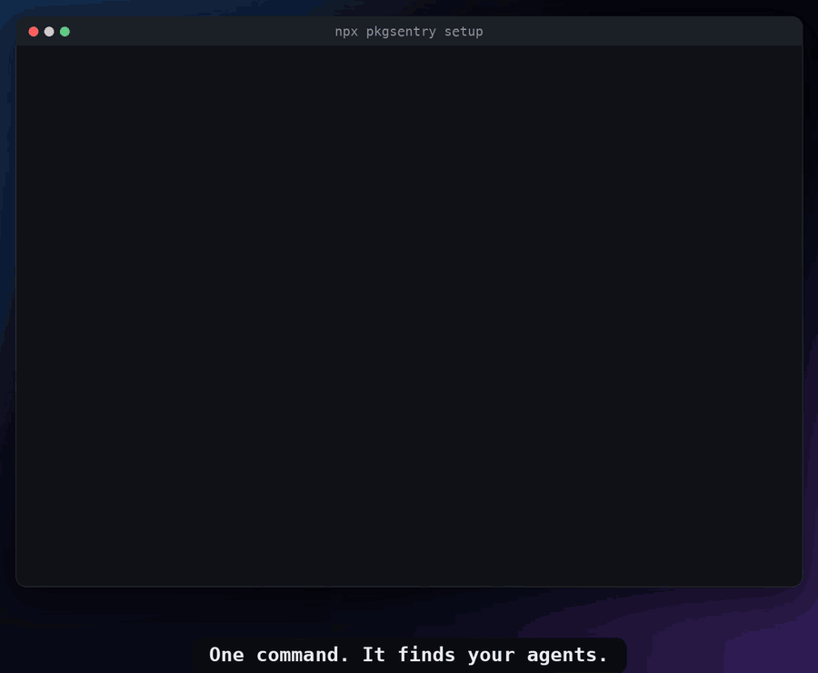

# pkgsentry

**Stops AI coding agents from installing hallucinated, typosquatted, or malicious packages.**

Claude Code, Cursor, Codex and friends run `npm install` and `pip install` on your machine. Sometimes the package name is made up. Sometimes it's one letter off from a real one. Attackers register exactly those names. pkgsentry checks every package before the install runs.



```bash
npx pkgsentry setup
```

That's it. It finds the agents you have installed, shows you exactly what it will change, and asks before writing anything.

[](https://github.com/MntRushmore/pkgsentry/actions/workflows/ci.yml)  

## Why this exists

Language models are good at naming packages that *sound* right. When you ask about common tasks they're nearly always correct. Ask about anything niche and they start inventing names.

We measured it. We asked Claude Haiku and Claude Sonnet (no web access) to name packages for about 480 programming tasks, then looked every name up:

| Prompt | Unique names suggested | Don't exist on the registry |
|---|---|---|
| Common tasks ("parse YAML", "hash passwords") | 220 | **0** (0%) |
| Niche integrations, 3 alternatives each ("Victron VE.Direct driver", "Bambu Lab MQTT client") | 590 | **272** (46%) |

Every one of those 272 names is free for anyone to register. That attack has a name, **slopsquatting**, and it isn't hypothetical: when a security researcher registered `huggingface-cli`, a name models kept suggesting, it was downloaded thousands of times. Add classic typosquats (`lodahs`, `reqeusts`, `scikit-lean`) and an agent with shell access is one confident guess away from running someone else's `postinstall` script.

pkgsentry sits in front of that install.

## What it does

```
$ npx pkgsentry check pypi reqeusts
  BLOCK  reqeusts (pypi)
  - Doesn't exist on PyPI. Did you mean "requests"?
```

- **`pkgsentry check <npm|pypi> <name>[@version]...`**: ALLOW / WARN / BLOCK with reasons. `--json` for machines.
- **`pkgsentry run -- <install command>`**: parses the command, checks every package, and only runs it if nothing is blocked. WARN asks first (or pass `--yes`).
- **Claude Code hook**: a `PreToolUse` hook on Bash. Blocked installs are denied before they run, and the reason goes back to Claude so it can fix the name itself. Warnings ask you.
- **MCP server**: a `check_package` / `check_install_command` tool for Cursor, Windsurf, Codex, or any MCP client, plus a rules file telling the agent to use it.

It understands `npm`, `pnpm`, `yarn`, `bun`, `npx`, `pnpm dlx`, `bunx`, `pip`, `pip3`, `python -m pip`, `uv pip`, `uv add`, `uvx`, `uv tool`, `pipx`, `poetry`, and `pdm`, including `-r requirements.txt` files, compound commands (`cd api && pip install ...`), env prefixes, `sudo`, and `bash -c "..."`.

Zero runtime dependencies. A supply-chain tool shouldn't bring its own supply chain.

## Install

```bash
npx pkgsentry setup          # detect agents, show the diff, ask, write
npx pkgsentry setup --dry-run
npx pkgsentry uninstall      # removes exactly what setup added
```

| Agent | What `setup` adds | Enforcement |
|---|---|---|
| Claude Code | `PreToolUse` hook on `Bash` in `~/.claude/settings.json` | **Hard**: blocked installs never run |
| Cursor | MCP server in `~/.cursor/mcp.json` + `.cursor/rules/pkgsentry.mdc` in the current project | Agent is instructed to check first |
| Windsurf | MCP server in `~/.codeium/windsurf/mcp_config.json` + global rule | Agent is instructed to check first |
| Codex CLI | `[mcp_servers.pkgsentry]` in `~/.codex/config.toml` + `~/.codex/AGENTS.md` | Agent is instructed to check first |

Every file is backed up to `<file>.pkgsentry.bak` before it's changed. Setup is idempotent. Want just one agent? `npx pkgsentry setup cursor`.

The MCP integrations depend on the agent following its rules. For hard enforcement anywhere, use `pkgsentry run -- <command>` or install globally (`npm i -g pkgsentry`) so the hook and MCP server start faster than through `npx`.

## How scoring works

Every check collects signals. Each adds points. Some block outright.

| Signal | Points | Notes |
|---|---|---|
| Package doesn't exist | **BLOCK** | Likely hallucinated. Suggests the closest popular name. |
| Known malware ([OSV.dev](https://osv.dev)) | **BLOCK** | `MAL-*` advisories and GHSA malware (CWE-506). Only blocks if the version you'd get is affected: `has-ansi@6.0.1` was compromised in Sept 2025, `has-ansi` today is fine. |
| npm replaced it with a security placeholder | **BLOCK** | npm's `0.0.1-security` stub for removed malware. |
| Lookalike of a top-5,000 package | 50 | Edit distance 1 (names of 4-7 chars) or 2 (8+), adjacent swaps, `-`/`_`/`.` confusion, missing scope (`types-node`), homoglyphs (`l`/`1`, `rn`/`m`). Ignored if the package itself has 10k+ weekly downloads. |
| First published < 7 days ago | 35 | |
| First published < 30 days ago | 25 | |
| Fewer than 50 downloads last week | 25 | npm downloads API, pypistats.org |
| Fewer than 1,000 downloads last week | 10 | |
| Install script that fetches or evals | 35 | `preinstall`/`install`/`postinstall`/`prepare` containing `curl`, `wget`, `eval`, `base64`, `child_process`, URLs... |
| Any install script | 20 | npm only. Not counted for popular packages (esbuild, sharp...). |
| Linked repository doesn't exist | 25 | GitHub/GitLab/Bitbucket/Codeberg. Uses `GITHUB_TOKEN` if set. |
| No repository linked | 10 | |
| Pinned version doesn't exist | 25 | |
| Pinned version has known vulnerabilities | 25 | |
| Deprecated | 10 | |
| Some past versions were malware | 15 | |
| Couldn't reach the registry | 30 | Fails toward WARN, never silently ALLOW. |

**70+ is BLOCK, 25+ is WARN**, anything lower is ALLOW. Popular packages (top 5,000 or 50k+ weekly downloads) are capped at WARN unless a hard-block signal fires, because heuristics alone should never stop you installing `express`.

So a two-day-old lookalike of `lodash` with nine downloads is blocked (50 + 35 + 25). A brand new, barely used package with a real repo gets a warning. A new package with an install script and no users is blocked.

The top-5,000 lists ship in [`data/`](data) (from [npm-high-impact](https://github.com/wooorm/npm-high-impact) and [top-pypi-packages](https://github.com/hugovk/top-pypi-packages)). Refresh them with `npm run refresh-top`. A GitHub Action opens a PR monthly.

## Benchmark

200 package names: 100 bad, 100 good, half npm and half PyPI. Run it yourself with `npm run bench`.

| | Bad names blocked | Bad names blocked or warned | Good names blocked (false positives) | Good names warned |
|---|---|---|---|---|
| **pkgsentry** | **100%** (100/100) | 100% | **0%** (0/100) | 2% (2/100) |
| without OSV.dev | 100% | 100% | 0% | 2% |

| Category | Source | n | BLOCK | WARN | ALLOW |
|---|---|---|---|---|---|
| Hallucinated (bad) | Names Claude Haiku / Sonnet suggested that don't exist on the registry | 50 | 50 | 0 | 0 |
| Typosquats (bad) | Real malware from OSV.dev whose name is a lookalike of a top-1,000 package | 50 | 50 | 0 | 0 |
| Popular (good) | Random sample of the top 5,000 | 50 | 0 | 0 | 50 |
| Long tail (good) | Random sample of ranks 5,001-15,000, which pkgsentry's bundled list doesn't include | 50 | 0 | 2 | 48 |

The two warnings are `falafel` and `matrx-ai`, real packages whose linked GitHub repositories return 404. The signal is accurate, but they're not malicious.

Latency per package: **~10ms cached** (p95 15ms), ~335ms uncached (p95 1.2s), measured on the machine that ran the benchmark.

### Method

[`bench/collect.mjs`](bench/collect.mjs) builds [`bench/dataset.json`](bench/dataset.json). Every sample uses a fixed seed, so it's reproducible.

- **Hallucinated.** Two rounds of prompts to Claude Haiku and Claude Sonnet running as subagents with tool access disabled, saved verbatim in [`bench/sources/model-suggestions.jsonl`](bench/sources/model-suggestions.jsonl). Round 1 asked for one package per common task; round 2 asked for three packages per niche integration. Every unique name was looked up on the registry, and we sampled 25 per ecosystem from those that don't exist.
- **Typosquats.** We sampled `MAL-*` advisories from OSV.dev's public index (25,000 npm, 4,000 PyPI, since npm's feed is mostly spam and dependency-confusion packages) and kept those whose name is within plain Levenshtein distance 2 (or a separator variant) of a top-1,000 package, then sampled 25 per ecosystem. The selection uses its own simple Levenshtein, not pkgsentry's detector.
- **Good.** Random samples of real, popular packages and of the long tail just below the bundled list, so the false-positive number isn't just "it's on our allowlist".

### What this benchmark does *not* show

Be skeptical of 100%. Here's why it's 100%:

- All 50 hallucinated names **don't exist**, so they're blocked by a registry 404. That's the real-world case, since a hallucinated name is harmless until someone registers it, but it's the easy case.
- All 50 malicious typosquats **had already been removed** by npm or PyPI (26 return 404, 24 are npm security placeholders). pkgsentry blocks them, but so would the registry by now.

That's why "without OSV.dev" scores the same. **The heuristic signals (age, downloads, lookalike names, install scripts) protect you in the window between an attacker publishing and the registry reacting. This dataset doesn't measure that window.** Measuring it properly means replaying malware against registry snapshots from when it was live. If you want to help build that, see [CONTRIBUTING.md](CONTRIBUTING.md).

Anecdotally, live packages do get flagged by heuristics alone: `expresss` (1 edit from `express`, 739 downloads/week, no repo) is blocked, and `react-codeshift` (published this year, 15 downloads/week, no repo) gets a warning.

## Configuration

Zero config by default. To trust packages your team uses (private registry packages would otherwise 404), add `.pkgsentry.json` to your repo:

```json
{
  "allow": ["internal-utils", "npm:@acme/*", "pypi:our-private-lib"],
  "block": ["npm:event-stream"]
}
```

Rules without a prefix apply to both ecosystems. A trailing `*` matches anything after it. `block` wins over `allow`. pkgsentry uses the nearest `.pkgsentry.json` walking up from the current directory, plus `~/.pkgsentry/config.json` if it exists.

| Environment variable | Effect |
|---|---|
| `PKGSENTRY_HOME` | State directory (default `~/.pkgsentry`) |
| `PKGSENTRY_NO_CACHE=1` | Skip the cache |
| `GITHUB_TOKEN` | Accurate repository checks via the GitHub API |
| `NO_COLOR` / `FORCE_COLOR` | Terminal colors |

Registry lookups are cached in `~/.pkgsentry/cache` for 24 hours (missing packages for 1 hour, OSV results for 6). `pkgsentry cache clear` empties it.

## Output

```
$ npx pkgsentry check npm lodahs expresss express
  BLOCK  lodahs (npm)
  - Known malicious package (MAL-2025-25502): Malicious code in lodahs (npm)
  - npm removed this package for malicious content and replaced it with a placeholder.
  BLOCK  expresss (npm)  since 2016 · 739 downloads/week
  - Name is 1 edit away from popular package "express". Possible typosquat.
  - Low usage: 739 downloads last week.
  - No source repository linked.
  ALLOW  express (npm)  top-5000 npm package
```

Exit codes: `0` ALLOW, `1` WARN, `2` BLOCK, `64` usage error. `--json` prints `{ verdict, results: [{ name, verdict, score, signals: [{ id, severity, points, message }], suggestion, ... }] }`.

## Use it as a library

```ts
import { createChecker, parseInstallCommand } from 'pkgsentry';

const { packages } = parseInstallCommand('pip install -r requirements.txt flask');
const results = await createChecker().checkAll(packages);
```

## Limitations

- npm and PyPI only for now. Cargo, Go, and RubyGems are [good first issues](https://github.com/MntRushmore/pkgsentry/issues?q=is%3Aissue+is%3Aopen+label%3A%22good+first+issue%22).
- Packages from private registries look nonexistent to pkgsentry. Allowlist them.
- `npm install` with no arguments (installing from `package.json`) isn't checked yet.
- Cursor, Windsurf, and Codex enforcement relies on the agent following its rules file. Only the Claude Code hook can block on its own.
- The command parser covers what agents actually type, not all of POSIX shell. If you find a bypass, please report it privately (see [CONTRIBUTING.md](CONTRIBUTING.md#security)).

## Contributing

New ecosystems are the most useful contribution, and the adapter interface is small. See [CONTRIBUTING.md](CONTRIBUTING.md).

## License

MIT
